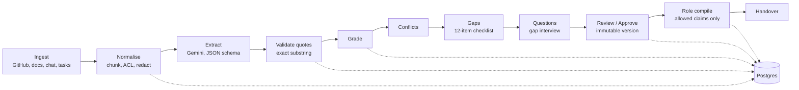

# Baton

**Hand over the project, not just the files.**

When a tech lead graduates or moves on, the repo survives but the knowledge does not: why auth moved,
which decision was overturned, who holds the production password. Baton rebuilds a project's live state from
authorised sources (GitHub, docs, chat, task boards), grades every claim against an exact quoted source span,
asks the departing person only what the records cannot answer, and gives each successor an approved,
role-safe continuation plan.

## Live demo

**https://baton-qxyj.onrender.com**

Tip: click 'Reset demo' in the top bar to restore the original state.

No login, no setup, no API key. The demo project, **FestFlow** (a college fest's registration and ticketing app),
is preloaded with a full pipeline result. The first open can take up to a minute if the free server was asleep.

## How to judge in 60 seconds

**Fast path:** open the demo and click **60-second tour** on the landing page. It walks the seven key screens and
switches persona for you.

**Manual path:**

1. Open **Open live demo**. The dashboard shows readiness, grade counts, bus factor and what needs attention.
2. **Evidence Ledger** → open the *Firebase → Supabase* claim. The drawer shows each exact quote highlighted in its
   source (PR #84, chat 12-Mar, notes 14-Mar) and why it earned VERIFIED.
3. **Conflicts** → switch to **Prof. Rao** and resolve *Razorpay (notes 02-Apr) vs PhonePe (#payments 19-Apr)*.
4. **Review** → approve **v1** (an immutable snapshot; the owner cannot self-approve).
5. Switch to **Arjun** and open **Handover**: his plan, acknowledgements, and "N claims hidden, request access"
   for restricted material. Then open **Trust**: leakage matrix shows **0 leaks**.

### "Viewing as" personas

There is no login. The switcher in the top bar sets a cookie, and every server action checks it.

| Persona | Role | Can do |
|---|---|---|
| Meera Kulkarni | Owner (departing tech lead) | Connect and label sources, see all claims, edit/reject, resolve conflicts, answer the gap interview. Cannot approve her own handover. |
| Prof. S. Rao | Reviewer (faculty coordinator) | See Team and Restricted claims, edit/reject, resolve conflicts, approve a version. |
| Arjun Mehta | Incoming (successor) | Read his role-compiled handover, acknowledge sections, ask follow-ups. Sees Restricted sources only if the owner granted them. |
| Kabir Shah | Observer (club member) | Read-only, Public data only. |

**Reset demo** (top bar) restores the seed in one click, so judges can't break it for each other.

## Three ideas that set it apart

### 1. Evidence Ledger: no claim without a receipt
- Every claim carries five possible grades: **VERIFIED, SINGLE_SOURCE, INFERRED, CONFLICTING, MISSING**, each with
  a human-readable reason ("2 independent sources: PR #84, notes 14-Mar").
- Gemini must quote evidence verbatim. A deterministic validator normalises whitespace, case and smart quotes, then
  requires an exact substring match inside the cited chunk. Invalid evidence is dropped; a claim with none is
  discarded or marked INFERRED, never VERIFIED.
- Contradictions become side-by-side conflicts; "we moved to X" supersessions are shown as evolution on a timeline,
  not as conflicts.

### 2. Gap-driven exit interview: answers become testimony
- A 12-item handover checklist (credentials owner, prod access, deadlines, recurring problems, ...) is run against
  the claims. Every unmet item becomes a MISSING claim.
- At most 10 questions are ranked by risk weight × dependent claims, each with a rationale and linked evidence.
  Meera is asked only what the records cannot answer (for example, who holds the production DB password).
- Answers are stored as TESTIMONY sources and badged as such, never styled as verified fact.

### 3. Permission-aware compilation, before the LLM
- Sources carry Public / Team / Restricted labels, inherited by chunks and claims (max of their evidence).
- `compileRoleView` selects only claims whose evidence chunks are all allowed for the role. The model that writes
  the overview and the 7/30-day plan receives **only** those claims and chunks; the rest is a hidden count.
- After compiling, the output is scanned for canary strings from non-allowed chunks. The result per role is on the
  Trust page and must be 0.

## Architecture



| Layer | Technology |
|---|---|
| App | Next.js 16 (App Router), TypeScript strict |
| Styling | Tailwind CSS v4, shadcn/ui primitives restyled to Baton tokens |
| Data | Prisma 7 + PostgreSQL on Render |
| LLM | Gemini 3.5 Flash (`gemini-3.5-flash`) via `@google/genai`, zod-validated structured output |
| 3D | Three.js via react-three-fiber (client-only, lazy-loaded) |
| Charts / motion | Recharts, Framer Motion |
| Hosting | One Render web service + Render Postgres (`render.yaml`) |

## Reliability

The demo must never depend on a live model call.

- **LLM cache:** every call is keyed by a hash of model + prompt + schema and stored in `LlmCache`.
- **Retries and limits:** exponential backoff, a 60 s timeout per call and a 40-call budget per run.
- **Cached fallback:** with no `GEMINI_API_KEY`, or if a call fails, the run falls back to the committed
  `seed/pipeline-cache.json` in CACHED mode, with a small neutral notice. Viewing never needs a key.
- Pipeline progress streams over SSE; no queue or Redis to fail.

## Data and privacy

- **Synthetic data only.** FestFlow and the sample project are fictional; the "secret" in chat is a made-up
  `ffk_live_` token.
- **Redaction before storage and before any LLM call:** secrets, emails and phone numbers are replaced by
  placeholders. Secret values are never stored, only that one existed and who mentioned it.
- **Server-side role filtering:** permissions are checked in `src/lib/authz.ts` before queries and before any LLM
  call, never only in the UI. Hidden claims never leave the server, only counts.
- **Audit log:** every mutation writes an `AuditLog` row, visible on the Trust page.

## Metrics (FestFlow seed)

| Metric | Value |
|---|---|
| Claims | 67 (32 verified · 17 single source · 6 inferred · 6 conflicting · 6 missing) |
| Evidence quotes | 127, **100% valid** exact substrings |
| Canary leakage | **0 leaks** across 4 roles |
| Sources / chunks / redactions | 40 / 122 / 4 |
| Conflicts | 3 open contradictions + 3 supersessions |
| Gap questions | 10 |
| Unit tests | 166 passing across 17 files (vitest: permission matrix, access rules, quote validation, grading, pipeline) |
| End-to-end | 3/3 Playwright specs passing (core handover workflow, /new wizard, guided tour) |
| Lighthouse (landing, desktop) | 100 performance · 100 accessibility · 100 best practices |

## Run locally

Requires Node 20+ and a PostgreSQL database.

| Variable | Purpose |
|---|---|
| `DATABASE_URL` | PostgreSQL connection string (required) |
| `GEMINI_API_KEY` | Enables live pipeline runs; without it the app serves cached results |
| `GEMINI_MODEL` | Gemini model name |
| `ADMIN_TOKEN` | Protects admin-only routes |
| `GITHUB_TOKEN` | Optional, raises GitHub API limits for live repo import |
| `NEXT_PUBLIC_APP_URL` | Public URL of the app (`http://localhost:3000` locally) |

```bash
cp .env.example .env        # fill in DATABASE_URL at minimum
npm install
npm run db:deploy           # apply migrations
npm run db:seed             # load FestFlow fixtures + cached pipeline result
npm run dev                 # http://localhost:3000

npm test                    # permission matrix tests
npm run typecheck && npm run build
npm run seed:verify         # independently re-checks the cached quotes, grades and access
```

Health check: `GET /api/health` returns `{ "ok": true, "db": true }`.

## AI and tools disclosure

- **In the product:** Gemini 3.5 Flash (`gemini-3.5-flash`, via `@google/genai`) extracts claims, labels conflicts, and writes the
  role-scoped overview and 7/30-day plan. Every extracted quote is verified by deterministic code, not by the model.
- **To build it:** Claude Code (Anthropic) was used as a coding assistant.

## Known limitations

- The free Gemini quota is small, so the deployed demo serves the cached pipeline result; live runs are a bonus.
- Identity is a demo persona switcher without login, by design for judging. Real deployments need SSO.
- Connectors today: GitHub public repos, file uploads (.md .txt .csv .json .docx).

## Round 3 roadmap

- Voice answers in the exit interview
- Knowledge-at-risk radar that flags single-owner areas before anyone gives notice
- Grounded Q&A on the approved handover, with the same quote receipts
- Incremental re-sync instead of full re-runs
- Slack and Google Drive connectors

## Team

Akshaya · VIT Pune · Varad Rathor, Kartik Patil, Rohan Agasti

---

Product spec: `CLAUDE.md`. Build status: `PROGRESS.md`. Demo video script: `docs/DEMO_SCRIPT.md`.
