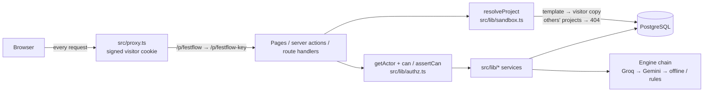
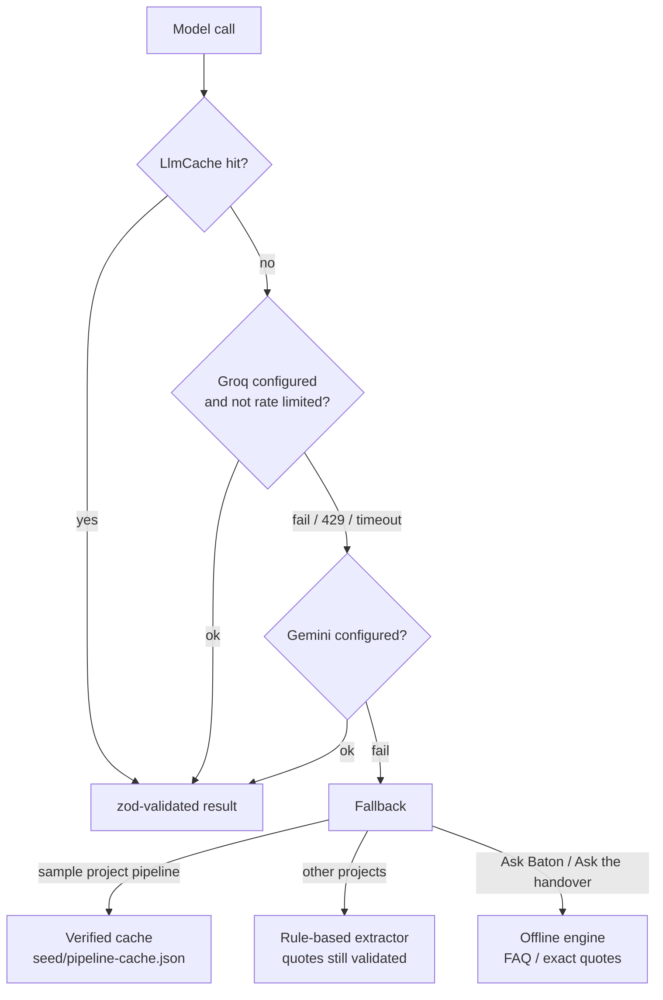
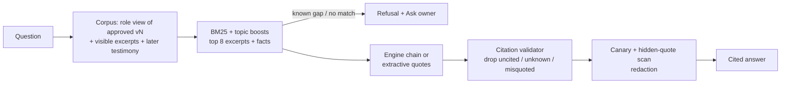
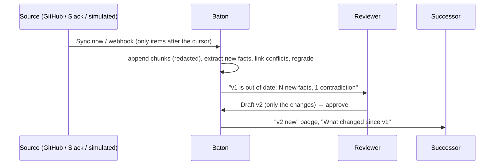
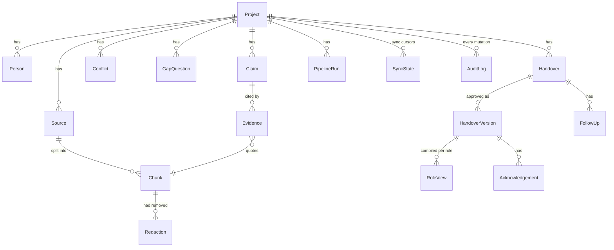

# Architecture

One Next.js 16 app (App Router, route handlers, server actions) on one Render web service, with Render
PostgreSQL. No queue and no cache server: long work streams over SSE from a route handler, and
everything is in Postgres. Business logic lives in `src/lib/*`, UI in `src/components/*`, pages are thin.

## Request path

- **Visitor identity** (`src/lib/visitor.ts`): an HMAC-signed anonymous cookie. The proxy forwards the
  verified id upstream and redirects the shared demo URL to the visitor's private copy.
- **Sandboxes** (`src/lib/sandbox.ts`): the first request clones the FestFlow template in one
  transaction with id suffixes (`clm_auth_supabase~<key>`). Copies expire 24 h after last use; projects
  made in `/new` belong to their creator and expire after 7 days idle. Cleanup runs at start-up, hourly,
  and on `GET /api/cron/cleanup`.
- **Personas** (`getActor`): the "Viewing as" cookie picks the role; every service call does `assertCan`
  before any query or model call.

## Pipeline

```mermaid
flowchart LR
  I[Ingest<br/>files · PDF · GitHub · Slack · ZIP] --> N[Normalise<br/>chunk ~800 chars, locators,<br/>identity map, REDACT]
  N --> E[Extract<br/>JSON schema, verbatim quotes]
  E --> V[Validate quotes<br/>exact substring, drop invalid]
  V --> G[Grade]
  G --> C[Conflicts<br/>contradicts / supersedes]
  C --> K[Gaps<br/>12-item checklist]
  K --> Q[Questions ≤10<br/>risk × dependents]
  Q --> R[Review & approve<br/>immutable version]
  R --> RC[Role compile<br/>allowed facts only + canary scan]
```

- `src/lib/pipeline/run.ts` runs all stages for a project and streams `{stage,status,counts,ms}` over SSE;
  each finished stage is also written to the run row so a refreshed page can follow it.
- `src/lib/pipeline/incremental.ts` runs the same stages on new chunks only (sync, webhook, Slack,
  simulated activity) and persists a delta: new facts, new evidence on existing facts, new conflicts.
  Reviewer edits, rejections, testimony and resolutions are never rewritten.
- One run per project at a time: a partial unique index on `PipelineRun(projectId) WHERE status='RUNNING'`,
  with stale runs (5 min) failed by the app.

## Engines and fallbacks

Budgets: per-run call budget, 15-20 s timeouts, no retries on 429 (the engine is benched for a minute),
per-IP limits for chat and Q&A. The demo never depends on a live model.

## Ask the handover

## Continuous handover

## Data model (main tables)

Also: `LlmCache` (model answers by hash), `Connection` (Slack OAuth tokens, encrypted). `Project.kind`
is TEMPLATE / SANDBOX / STANDARD; `Source.externalId` + item keys make re-syncs idempotent; `Chunk.meta`
keeps per-message links (Slack permalinks).

## Permission model

| Action | Owner | Reviewer | Successor | Observer |
|---|---|---|---|---|
| Connect / label / sync sources, Slack | ✓ | – | – | – |
| See Restricted facts | ✓ | ✓ | only granted sources | – |
| See Team facts | ✓ | ✓ | ✓ | – |
| Edit / reject facts, resolve conflicts | ✓ | ✓ | – | – |
| Answer interview and follow-ups | ✓ | – | – | – |
| Approve a version | – (no self-approval) | ✓ | – | – |
| Acknowledge, follow-ups, Ask owner | – | – | ✓ | – |
| Ask the handover | ✓ | ✓ | ✓ | ✓ (Public only) |

A fact is visible only if every chunk it cites is visible to the role. Hidden facts never leave the
server; only their count does.
